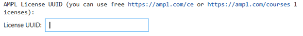
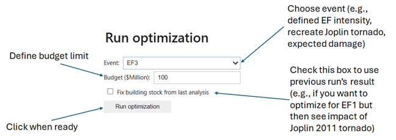
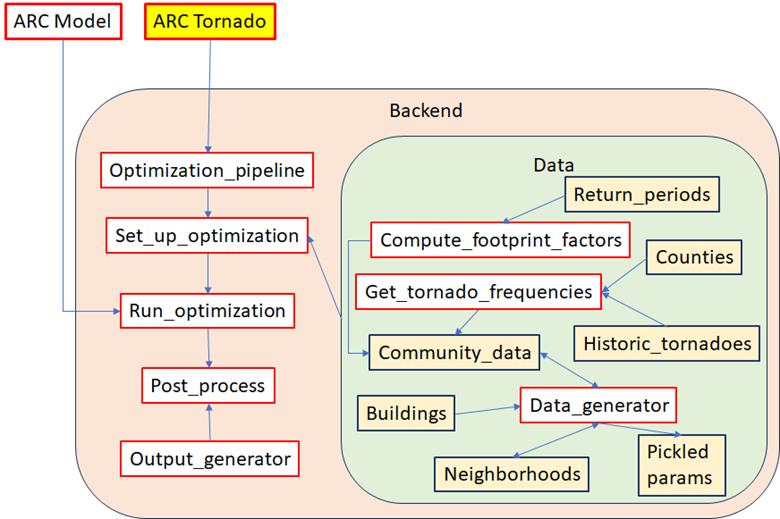

# ARC-Tornado
Data and codes for running the Alternatives for Resilient Communities (ARC) tornado model, designed to inform optimal mitigation and retrofit strategies for communities affected by tornadoes
# Reference
Hughes, W., Faiz, T. I., Levitan, M., & Harrison, K. (2025). "An Optimization Model to Inform Alternatives for Resilient Communities for Tornado Wind Retrofits." _Sustainable and Resilient Infrastructure._ doi:[10.1080/23789689.2025.2597164](https://www.tandfonline.com/doi/full/10.1080/23789689.2025.259716)

# Contacts 
Kenneth Harrison (Kenneth.harrison@nist.gov)
William Hughes (William.hughes@nist.gov)

# Git Repository
[https://github.com/usnistgov/whughesnist/ARC-Tornado](https://github.com/usnistgov/whughesnist/ARC-Tornado)

# NIST Landing page
[https://doi.org/10.18434/mds2-3826](https://doi.org/10.18434/mds2-3826)

# ARC Home Page
[Link to NIST ARC Homepage](https://www.nist.gov/services-resources/software/nist-arc-nist-alternatives-resilient-communities-tool)

# Installation
The model uses Python Jupyter notebooks and AMPL commercial optimization solver. The model will automatically install any necessary packages.

The Jupyter notebooks can be run in several ways (e.g., Anacona, VScode).
You may need to obtain a community license from AMPL. If so: you can use free https://ampl.com/ce or https://ampl.com/courses licenses and input the UUID accordingly. Make sure the CPLEX solver is also included.

# Running the models
•	Once voila is installed (after running the fist cell), it can be used to run the interactive dashboard by clicking the following button on the top toolbar:

•	Input your AMPL license ID

 
•	There are details within the notebook on how model parameters can be updated in the backend
•	Run the optimization model

 
•	Visualize results

# Code Details
The flow of information in the ARC tornado model is outlined in Figure 1. The interface to run ARC is the Jupyter notebook ‘ARC Tornado.’ This is an interactive user dashboard where different tornado events and budgetary constraints can be analyzed, allowing for visualization of results in a variety of formats. The code calls several files within the backend, starting with the optimization pipeline, which first initializes the optimization parameters, then loads them into AMPL for solving before passing to the postprocessing. Within the ‘Data’ subfolder of the backend, parameters are generated and preprocessed by the ‘Data generator’ file to quickly call defined events. Users can define their own events using these files and updating the appropriate data paths. The files are described in details in the next section.

# File Descriptions
The flow of data is shown in Figure 1. Along with this Readme file, the ‘front end’ contains the AMPL ARC .mod file and the interactive Jupyter notebook for running the model. Meanwhile, the back end folder contains the codes for setting up and running the model, the data input into the model, and preprocessing scripts to generate the data and parameters.

 
Figure 1. Flow of information in ARC Tornado Model

# Front end:

•	**ARC_Tornado.ipynb**: This is the main interactive dashboard. It uses widgets to allow for users to define various budgets and tornado event sets. It then calls the optimization pipeline, solving the problem and presenting results in a variety of formats to be chosen by users.

•	**ARC_model.mod**: This is the code for the AMPL optimization. This defines the sets, parameters, constraints, and objective function. This code is loaded into Python’s AMPL API, where the parameters are defined within the optimization pipeline and the optimization is executed, with results subsequently processed.

# Back end:
•	**Optimization pipeline.ipynb**: This file controls the flow of the optimization process. It is called by the ARC Tornado widgets, and it calls the optimization set up, runs the optimization, and calls the postprocessor.

•	**Set_up_optimization.ipynb**: This code initiates the parameters for the optimization model. It calls the relevant data files to initialize and format the parameters before passing through the optimizer. This code is controlled by the optimization pipeline.

•	**Run_optimization.ipynb**: This code runs the optimization, calling the AMPL file and loading in the parameters before executing the optimization. It is called by the optimization pipeline.

•	**Post_process_results.ipynb**: This file post-processes the optimization results for output. It calls the output_generator functions to create the different maps and visualizations which are presented in the ARC Tornado main file.

•	**Output_generator.ipynb**: This file contains the functions to create various visualizations of the optimization results. It is called by the postprocessor.

• =======Data======:

• This section provides a brief overview of the data files. More specific details can be found in the **Data_description** word file within this subfolder.

• **Community_data.xlsx**: This file contains the key parameters relating to the community, including:

o Building archetype definitions

o Permissible upgrades

o Fragility parameters (mu, sigma)

o Economic parameters (discount rate, time period, cost of retrofits and casualties)

o Building repair costs

o Building areas

o Repair time parameters (mu, sigma)

o Distribution of residents in various buildings (written by data_generator)

o Frequency of tornado events (written by get_torando_frequencies)

o Building footprint factors (written by compute_footprint_factors)

• **Data_generator.ipynb**: This code computes the various parameters needed for the optimization model, as .pkl files, including:

  o	    Initial building portfolio (x_b_0.pkl) for building archetype and retrofit in each neighborhood (using data on the buildings and neighborhoods)
  
  o	    Casualty rates for varying damage severities conditioned on building DS
  
  o	    To calculate the residential distribution, census data related to the average household size and the proportion of workers in commercial and industrial sectors is utilized.
  
  o	For each defined event case:
  
   -	Damage state probabilities for neighborhoods, archetypes, and retrofit classes
   
   -	Modified damage state probabilities to consider casualties, where retrofitted buildings are set to DS0 to remove any casualties in these buildings
   
   -	Debris size for each building archetype/retrofit combo in each neighborhood given DS
   
   -	Restoration costs for each building archetype/retrofit combo in each neighborhood given DS
   
   -	Residents per building in each neighborhood and archetype
      
•	**Compute_footprint_factors.ipynb**: This code computes the building footprint factors affecting the probability of a larger building being hit by a tornado. It reads in the return periods determined by the ASCE 7 Hazard Tool and the areas of the archetypes, fits the curve, and outputs the factors for each archetype.

•	**Return_periods.xlsx**: Based on the ASCE 7 hazard tool, gives the wind speed (mph) for various mean recurrence intervals (MRI,years) and effective areas (ft2) for a specific region. It is read by the compute_footprint_factors code to generate the footprint factors.

•	**Get_tornado_frequencies.ipynb**: File to generate frequencies of weighted events. It reads in historic_tornadoes and counties data to write the expected number of tornadoes of each intensity.

•       ** Buildings**: Shapefile of building footprints

•       **Counties**: Since the community level may be too small to draw accurate conclusions about tornado frequency, shapefile of the larger county level is used to analyze historic data. 

•	**Historic_tornadoes**: Shapefile from SVIRS of historic tornado paths and intensities, used to compute tornado frequency

•	**Neighborhoods**: Shapefile of neighborhoods (e.g., Joplin census blocks)

•	**Census_data**: Census data from American Community Survey 

•	**Fix_commands**: commands to freeze building stock for reanalysis of same building portfolio under various conditions

• **Figures**: These files link to the schematics shown in the readme.

# Disclaimer:
NIST-developed software is provided by NIST as a public service. You may use, copy, and distribute copies of the software in any medium, provided that you keep intact this entire notice. You may improve, modify, and create derivative works of the software or any portion of the software, and you may copy and distribute such modifications or works. Modified works should carry a notice stating that you changed the software and should note the date and nature of any such change. Please explicitly acknowledge the National Institute of Standards and Technology as the source of the software. 

NIST-developed software is expressly provided "AS IS." NIST MAKES NO WARRANTY OF ANY KIND, EXPRESS, IMPLIED, IN FACT, OR ARISING BY OPERATION OF LAW, INCLUDING, WITHOUT LIMITATION, THE IMPLIED WARRANTY OF MERCHANTABILITY, FITNESS FOR A PARTICULAR PURPOSE, NON-INFRINGEMENT, AND DATA ACCURACY. NIST NEITHER REPRESENTS NOR WARRANTS THAT THE OPERATION OF THE SOFTWARE WILL BE UNINTERRUPTED OR ERROR-FREE, OR THAT ANY DEFECTS WILL BE CORRECTED. NIST DOES NOT WARRANT OR MAKE ANY REPRESENTATIONS REGARDING THE USE OF THE SOFTWARE OR THE RESULTS THEREOF, INCLUDING BUT NOT LIMITED TO THE CORRECTNESS, ACCURACY, RELIABILITY, OR USEFULNESS OF THE SOFTWARE.

You are solely responsible for determining the appropriateness of using and distributing the software and you assume all risks associated with its use, including but not limited to the risks and costs of program errors, compliance with applicable laws, damage to or loss of data, programs or equipment, and the unavailability or interruption of operation. This software is not intended to be used in any situation where a failure could cause risk of injury or damage to property. The software developed by NIST employees is not subject to copyright protection within the United States.
Certain equipment, instruments, software, or materials are identified in this paper in order to specify the experimental procedure adequately.  Such identification is not intended to imply recommendation or endorsement of any product or service by NIST, nor is it intended to imply that the materials or equipment identified are necessarily the best available for the purpose.

